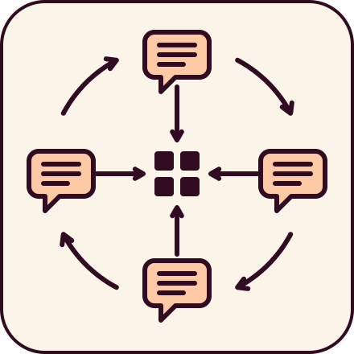
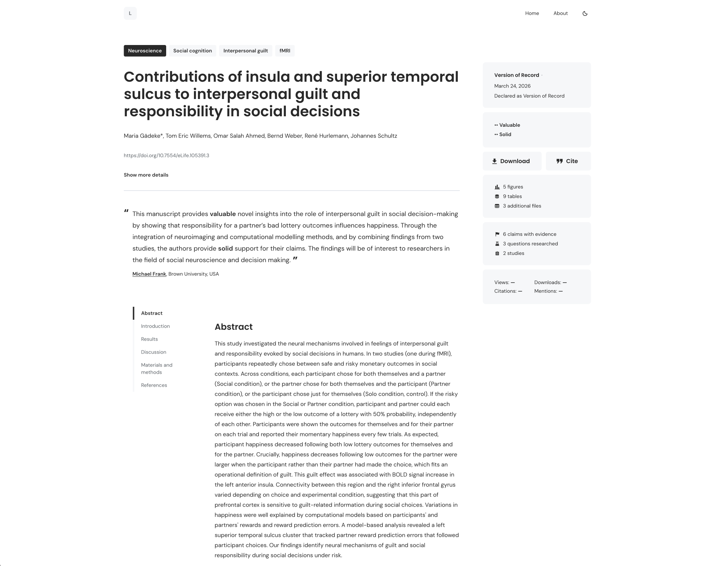
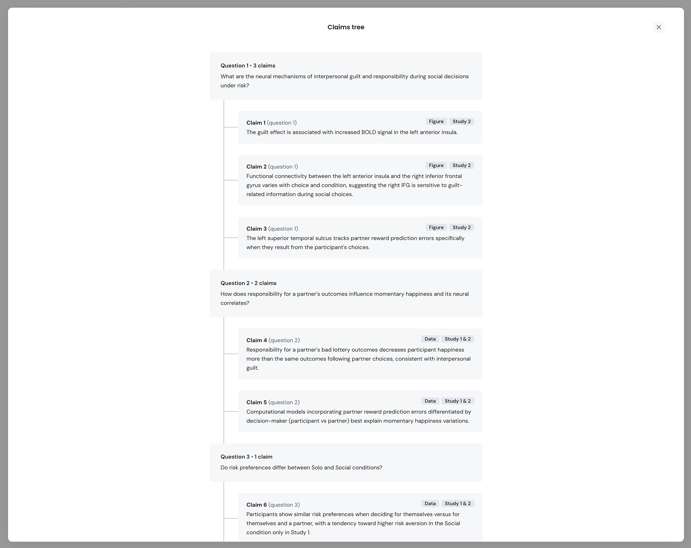

## **Introduction**

AI is speeding up the production of new results by carrying out parts of the research process, from generating hypotheses and running experiments to analysing data and writing up findings. But producing results isn't the same as verifying them and integrating them into the collective understanding that drives breakthroughs. 

That second step depends on how scientific knowledge is organised. Today’s scientific paper was designed for people to read, not for machines to reason over. A paper’s claims are woven into its narrative, and the evidence behind each one is distributed across figures, supplementary material, and repositories. Neither a researcher nor an AI system can easily ask: what exactly was shown here, and on what basis? Nor is it easy to understand the discourse the paper is embedded in. With science increasingly happening “off the record” in labs, on informal platforms like social media or blogs, it is too easy to miss important context that might exist.

**Modular science** responds to that problem. Research is shared as linked components: questions, claims, the evidence for each, and the data, code and methods behind them. People can assemble these into a familiar, readable narrative while keeping a structured, machine-readable record that human and AI scientists alike can check, reuse, and build on.

Since launching eLife Pathways in February 2026, we’ve become part of the fast-growing ecosystem and community around modular science. We first joined as participants in standards discussions and as technology builders, bringing technical expertise and real-world examples from the research communities we work with. Our role has grown from there. We’re now involved in many of the projects and technical meetings, talk regularly with researchers and funders, and have helped shape some of the terminology used for this approach. As a result, others have come to see us as “the glue” between initiatives, and as conveners. 

That vantage point is why we’re writing this post. In it, we share where we think modular science stands today, bring together the work of many others in the community, and set out the definitions and terms we’ve used and built on.

## **Drawing inspiration from our collaborators**

A vibrant community of technologists and advocates is laying the groundwork for modular science, transforming how we publish and assess research. 

Rowan Cockett of the [Continuous Science Foundation (CSF)](https://continuousfoundation.org/modular-science) highlighted this evolution in [*Towards Modular Open Science*](https://articles.continuousfoundation.org/articles/towards-modular-science), mapping the progression of scientific outputs from unstructured data to isolated repositories, and ultimately to rigid, monolithic journal articles. He uses the visual concept of building blocks: spread on a chaotic "floor" of scattered ideas, organised into "buckets" like data repositories, and finally into a rigid, glued-together set of objects like trophies on a "shelf". This image of sifting through a floor of blocks, or prising a trophy off the shelf, made the case for modularity click for us.

Rowan argues for research that is modular by design, so its parts stay flexible, connected, and reusable rather than locked into static formats. That matches our view that modules should be composable for different audiences: different reading experiences for different groups of people, and formats that work for machines and for researchers using LLMs and agents.

We recently worked with Rowan and others from Curvenote, openRxiv, Posit, Stencila, and Creative Commons to produce a paper for the SciPy conference proceedings that details the nascent [Open Exchange Architecture (OXA)](https://proceedings.scipy.org/articles/ejwp2755). OXA is an emerging open standard for representing research documents as linked modules, and we now use it in our own open-source software. The paper builds on earlier work by Rowan and CSF’s Courtney Babott, and contains a line we find ourselves quoting often:  

>Scientific communication remains trapped in a paper-shaped container. 

openRxiv is already breaking out of that container at scale. Its recent post sets out a plan to turn [preprints into structured records](https://openrxiv.org/preprints-as-research-record-our-roadmap/) that link the narrative to its data, code, protocols, reviews and provenance, in an open corpus that people and machines can both use. We strongly support this direction because it shows modular science moving into everyday publishing, and it's something we’re looking at more broadly too.

PLoS is developing a “[Knowledge Stack](https://explore.plos.org/practical-pathways-to-open-science#design)”, a structured, machine-readable record that links each article to its data, code, methods, and materials, with the aim of making these outputs as visible and citable as the article itself, without changing existing publishing workflows. 

Other complementary initiatives are building ways out of that container too. Emerging initiatives like [Collective Augmented Intelligence for Research & Open Science (CAIROS)](http://cairos.network) and [Modular Open Science, AI & Collective Intelligence (MOSAIC)](https://mosaic-program.org/) are linking modular frameworks such as Discourse Graphs with decentralised networks like ATProto. The result is open research infrastructure that unlocks knowledge from standard documents, enriches it with knowledge graphs and makes collaboration and discourse across the ecosystem easier.

Turning these ideas into practical infrastructure requires new standards to structure and connect modular elements. The [Modular Interoperable Research Attribution (MIRA)](https://www.mira.science/) community showcased this at their recent [kickoff event](https://mira.science/blog/what-we-built-at-the-mira-kickoff/), demonstrating how traditional text can be structured into open graphs of questions, claims, and evidence, building on Discourse Graphs. Its working prototypes—from cross-institutional dashboards to research networks running on ATProto—showed what transparent, collaborative research can look like in practice.

Together, these efforts show that the move away from monolithic papers is well underway. Our work at eLife Pathways builds on all of them. We’re helping to create an open, interoperable ecosystem that structures research into machine-readable components, so AI can reason over findings while researchers verify and validate the results.

### **Converging on community-derived definitions**

As modular science is a new term, over the past few months, we've gathered views and tested wording with the community: in online meetings with the OXA steering committee, the MIRA community's regular conversations with collaborators, and at a dedicated in-person session at the IOSP conference community day in Leiden, the Netherlands, in October, with 20 participants. Those discussions produced two working definitions. They're written so researchers, funders, publishers and tool builders can talk about modular science using the same terms.

## **What is Modular Science?**

>Modular science is a set of structured, composable research objects. In practice, creators share claims, evidence and individual research components (like code or data), and consumers can compose, reuse, remix and integrate them into new work.

In this definition, while we can call out some more significant modules from various standards under development, many more types exist today, and we’ll likely discover more as this ecosystem develops. This statement is simple enough for a broad understanding and highlights the modules that researchers are more familiar with right now.

>The modular science ecosystem is a collection of people, products and projects that implement modular science.

In our workshops, this statement was the easiest to agree with. It helps make it clear that we’re not talking about technology alone, but the people, communities, and other resources that come with it. 

The ATScience community has published a [map](https://atproto.science/ecosystem/) of its ecosystem, covering everything from early concepts to established, growing products. We plan to produce a similar map for modular science to reflect the whole ecosystem. If you'd like your project included, get in touch. We'd also welcome feedback on both definitions here.

## **The four pillars of modular science**

Modular science requires open protocols that break research into machine-readable parts, each carrying a visible record of how thoroughly it has been verified and validated. No single organisation can or should build this alone. That’s why the community, including us, is working together on a well-understood set of interlinked, interoperable components.

At eLife Pathways, we think about modular science in terms of four pillars. They cover how research is structured, connected, checked and discussed, and they guide where we focus our work. The framing is ours, but we hope it’s useful to others in the community too:

<figure>

<figcaption>Document representation</figcaption>
</figure>
<figure>

<figcaption>Knowledge representation</figcaption>
</figure>
<figure>

<figcaption>Integrity and evaluation</figcaption>
</figure>
<figure>

<figcaption>Discourse and sensemaking</figcaption>
</figure>

### **Document representation**

Figures, code, data, narrative, methods, computations, and provenance are represented as individually composable modules using the [Open Exchange Architecture (OXA)](https://proceedings.scipy.org/articles/ejwp2755) standard. 

A great example is the openRxiv Labs reader project, which has already [shown positive engagement with connected elements](https://openrxivlabs.org/articles/reader-button-launch) in the reading experience enabled by the modular standards used to produce the preprints. [Stencila](https://stencila.io/) (a platform for creating and publishing dynamic, data-driven documents) and our own Enhanced Preprint Platform also use OXA as a native format to reference specific modules within a document representation for novel reading experiences and to accelerate AI assistance.

### **Knowledge representation**

Questions, claims, evidence, studies and protocols are linked in a knowledge graph, showing how evidence supports or opposes a claim and how claims answer questions, using the [Modular Interoperable Research Attribution (MIRA)](https://www.mira.science/) standard. 

We’ve been exploring how to extract this type of information from existing papers and use it to design new reading experiences. Our intent with the display of questions, claims and evidence, which leverages the modular document representation to include relevant figures, text and anchor points, is to showcase the possibilities with modular science while helping readers understand more about how a machine might consume a paper by presenting trees and graphs in a more familiar reading interface.

### **Integrity and evaluation**

The lifecycle, review, curation and assessment of each work, such as [eLife Assessments](https://elifesciences.org/about/elife-assessments) and open peer reviews, are captured using the [Docmaps](https://docmaps.knowledgefutures.org/) standard. It records whether a claim came from a human or AI, what checks it has passed, and who carried them out.

At the moment, our examples incorporate existing journal workflows and journal-like review and curation activities. We expect that, in the future, this level of granularity will provide greater transparency when AI is involved in the process. We can further use this part of the protocol to provide tools for authors and independent reviewers to verify and validate any module, for example, by having independent peer review of claims extracted from papers.

### **Discourse and sensemaking**

Integrating researcher and public discussion of science into the scholarly record through decentralised, federated networking protocols such as [ATProto](https://atproto.com/) and [ActivityPub](https://activitypub.rocks/).

This treats curation as a way of organising content: making sense of it, grouping it into collections, linking related objects (as [Sciety](https://sciety.org/) and [Semble](http://semble.so) do), and adding structured opinions or informal reviews. We also want to include anywhere an object or module is discussed, starting with well-managed social networks—those built specifically for scientific discourse (like [Bonfire](https://bonfirenetworks.org/))—and moving to places where discussion is happening and could be shared.

## **Our work so far**

### **Clickable prototypes and a demonstration in a paper from eLife**

At eLife Pathways we don’t always produce prototypes; we like to have early working versions of software that we can iterate on. Our design tools' ability to connect to AI, though, has helped us turn feature-rich designs into working software, enabling more detailed feedback in user research and testing. We’ve produced prototypes with a ‘vanilla’ look and feel so readers aren't distracted by branding or journal names. Each showcases the modularity of the content on offer, with clear areas to summarise each module in the four pillars, plus a more detailed display that shows depth while leveraging interoperability between pillars. 

A good example is the paper’s knowledge representation display, which shows the question, the claims that answer it, and the evidence that supports those claims in the same linear view as the figure from the document representation, along with the text related to each specific claim and evidence. These are also linked directly from the narrative, allowing readers to move between the longer document and the specific claim-and-evidence view. 

Evaluation, journal-like curation, and social discourse are included as separate views, along with more traditional metrics like views, citations, and downloads.

Our prototypes are built on real papers and their extracted knowledge representations, but we have also gone a step further. We’ve created an independently verified graph of claims and evidence for a published eLife paper, and we have brought it to life in our Enhanced Preprint Platform—a version of the software that powers eLife’s journal—using our early integration of MIRA and OXA. We’ll be sharing it soon. It’s a first look at what a modular paper could be, and a step towards making full support for these standards available to everyone. 

### **Claims and evidence graph extraction pipelines**

To obtain the knowledge representations needed for a more modular approach, two main sources are emerging: researchers using tools like Discourse Graphs to produce these graphs in the lab, or researchers working with technologists to develop AI extraction tools that infer knowledge from a paper's semantic markup. This latter case is one [we’ve had plenty of interest in](https://elifesciences.org/inside-elife/6ad10e4e/elife-latest-exploring-ai-s-potential-for-improving-research-engagement), and we’re keen to explore more. To begin with, though, we have been working with [Zach Mainen](https://github.com/zmainen/elife-claim-trees/tree/main) on his eLife Papers pipeline, part of his [Haak project](https://haak.world/), because it retrieves graphs we can easily map to the MIRA standard, is open-source, and researchers in the fields we’ve been experimenting with have verified it.

The pipeline uses a multi-step, multi-agent approach to extract claims and evidence from different points of view, then consolidates and checks them before converting them into MIRA and OXA formats for our experiments.

### **Contributing to the OXA RFCs**

Through our work designing the user experience and building OXA into our software, we’ve contributed to the Request for Comments conversation helping formalise the OXA standard. It’s an open community specification that is stewarded by CSF, and we encourage others to join the conversation with us on [Discord](https://discord.oxa.dev/) or via [GitHub](https://github.com/oxa-dev).

### **CAIROS**

We are proud to be a part of the [CAIROS](https://cairos.network) network, a cooperative federation of open science projects working to build a collectively stewarded research commons. We officially joined CAIROS because its cooperative approach aligns perfectly with our mission. CAIROS operates on the principle that designing for collective intelligence requires AI and human systems to complement and improve each other, centring human agency and equitable data stewardship in the research process. By participating in this shared governance structure, we can collaborate more deeply with other tool builders, establish stronger interoperable protocols, and ensure that the future of modular science prioritises collective, sustainable progress over isolated tools. We recently received a donation from the John Templeton Foundation to help create governance structures and an official organisation for CAIROS, so we hope to expand the network and the opportunities it offers in the near future.

### **The National Academies of Sciences, Engineering, and Medicine (NASEM) Action Collaborative**

We were invited to join the US National Academies Roundtable on Aligning Incentives for Open Science as part of a focused Action Collaborative of experts to devise a framework that would enable sharing much earlier in a researcher’s workflow—well before a manuscript exists—to ensure the most comprehensive and reusable reporting possible. These regular virtual roundtable meetings, with an in-person event at the HHMI HQ in April this year, have culminated in a proposal that helps define how the research community can do this well and ensure all modules are [Versioned, Interoperable, Transparent, Auditable, Attributable, AI-Actionable, and Linked](https://www.convergescience.org/updates/2026-11-03-vital). These principles closely match what the modular science ecosystem is already building, and give us a clear way to show how the community is putting them into practice together. 

## **What’s next for eLife Pathways**

We’ll continue working with the wider research community to build the open-source foundation for a peer-reviewed, machine-readable graph of research claims and evidence that AI can reason over and extend, and that experts can verify and validate. Over the coming months, we’ll focus on these things.

1. **Developing the standards.** We’ll keep working with others on the OXA and MIRA schemas, and help bring other relevant standards into the ecosystem. One example is the [Agentic Schema for Transparent Research and Analysis (ASTRA)](https://astra-spec.org/latest/), which links results to the data, code, and decisions that produced them, so people can verify AI-generated analyses.  
2. **Researching how people interact with modular papers.** We’ll test how authors and readers use the modular parts of a paper, including how they want to access and interact with data, code, claims and evidence.  
3. **Scaling up extraction.** We’ll extend our claims-and-evidence extraction work with eLife collaborators, bringing in more expertise to validate the pipelines and keep a human in the loop.  
4. **Working towards a modular platform.** We’re working to bring standards, reading experiences, and extraction pipelines together in an open-source platform. The aim is for journals, preprint servers, and research communities to share, review, and read research as modular components without building the infrastructure themselves.

If you’d like hands-on help, we also offer development, customisation, integration, hosting and strategic support for moving to open, machine-readable publishing. **[Contact us](/blog/post-12-11-26/#get-involved).**

We'd also love to connect in person. You can catch up with us at upcoming events where we’ll be talking to different communities about modular science, including the [AI for Science Summit](https://ticmanchester.org/events/ai-for-science-summit/) on 26th November 2026 in Manchester, UK, the [Atmosphere Conference](https://atmosphereconf.org/), 29th April- 2nd May 2027 in Amsterdam, The Netherlands, and the [Convergence Conference](https://www.convergescience.org/) in Montreal, Canada on 16th-17th June 2027\. Come along and speak with us\!